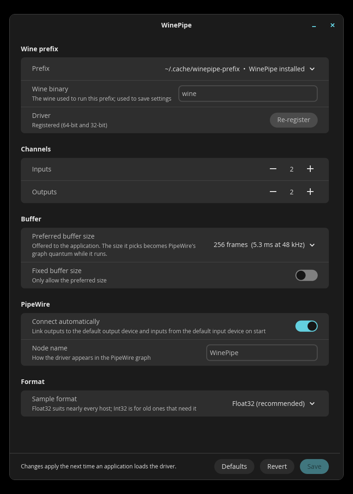

# WinePipe

An ASIO driver for Wine that talks to **PipeWire directly**: no JACK and no
`pw-jack`. Windows DAWs, plugin hosts and other ASIO software (FL Studio,
REAPER, …) show up as an ordinary PipeWire node with `in_N` / `out_N` ports,
linked to your default devices automatically.

* **Low latency.** The buffer size you pick in your DAW becomes PipeWire's
  graph quantum, and the host's audio goes back into the graph in the same
  cycle. The driver adds no buffering of its own.
* **Stable.** A DAW that stalls can never stall PipeWire. Every wait on the
  realtime path has a deadline, a late block costs exactly that block, and
  the stream recovers by itself. If PipeWire restarts, the DAW is asked to
  reset its audio device.
* **Modern Wine.** Built for Wine's PE/Unix split (Wine 10.2+ / 11),
  including WoW64. One Unix library serves both 64-bit and 32-bit
  applications.
* **Settings app.** A native COSMIC (libcosmic) settings window, which
  opens from your DAW's "ASIO panel" button.



## Install

### Arch Linux (AUR)

```sh
paru -S winepipe        # or yay -S winepipe
```

The package builds from source and installs the driver into
`/usr/lib/wine`.

### From source

Requirements:

* Wine with the PE/Unix split, plus `winebuild` (tested: 11.20 staging)
* PipeWire ≥ 1.0 (`libpipewire-0.3.so.0`; headers are not needed)
* Rust ≥ 1.93 with the `x86_64-pc-windows-gnu` and `i686-pc-windows-gnu`
  targets, and mingw-w64 (`x86_64-w64-mingw32-gcc`, `i686-w64-mingw32-gcc`)
* For the settings app: libxkbcommon and wayland

```sh
rustup target add x86_64-pc-windows-gnu i686-pc-windows-gnu
make                    # driver + settings app into build/
sudo make install       # PREFIX=/usr/local, WINELIBDIR auto-detected
```

`make driver` builds without the settings app. To use a custom Wine build,
install into that build's library directory instead, e.g.
`make install-driver WINELIBDIR=~/.local/opt/wine/lib/wine PREFIX=~/.local`.

### Register it in a Wine prefix

Once per prefix:

```sh
WINEPREFIX=~/.wine winepipe-register
```

This copies the builtin-marked DLLs into `system32` / `syswow64` and
registers both the 64-bit and the 32-bit driver. `winepipe-register -u`
removes them. If the prefix runs on a Wine other than the one on `PATH`, set
`WINE=/path/to/bin/wine`. The settings app can register prefixes too.

Then pick **WinePipe** as the ASIO device in your application.

## Settings

Open **WinePipe Settings** from the application menu, run
`winepipe-settings`, or press the ASIO control panel button in your DAW,
which opens the window for that application's prefix and Wine. Settings are
stored per prefix in `HKEY_CURRENT_USER\Software\WinePipe` and take effect
the next time an application loads the driver.

| Setting               | Default   |                                                       |
|-----------------------|-----------|-------------------------------------------------------|
| Inputs / Outputs      | 2 / 2     | channels (0–64)                                       |
| Preferred buffer size | 256       | buffer size offered to the host (16–8192)             |
| Fixed buffer size     | off       | the host may only use the preferred size              |
| Connect automatically | on        | link outputs to the default sink and inputs from the default source on start |
| Node name             | WinePipe  | PipeWire `node.name`                                  |
| Sample format         | Float32   | Float32LSB or Int32LSB                                |

From a terminal, `winepipe-config` does the same:

```sh
WINEPREFIX=~/.wine winepipe-config --inputs 8 --outputs 8 --buffer 128
WINEPREFIX=~/.wine winepipe-config            # show
```

Environment variables override the registry for a single run:
`WINEPIPE_INPUTS`, `WINEPIPE_OUTPUTS`, `WINEPIPE_BUFFER_SIZE`,
`WINEPIPE_FIXED_BUFFER_SIZE`, `WINEPIPE_AUTOCONNECT`, `WINEPIPE_SAMPLE_TYPE`,
`WINEPIPE_CLIENT_NAME`. `WINEPIPE_RT_PRIO` overrides the callback thread's
realtime priority (0 = don't request realtime scheduling).

**Sample rate.** The driver always reports the rate the PipeWire graph is
actually running at. If the DAW asks for another rate listed in PipeWire's
`clock.allowed-rates`, the graph switches to it while the DAW has the device
open, and switches back afterwards.

## How it compares to WineASIO

|                               | WineASIO (Wine 11 port)                       | WinePipe                                      |
|-------------------------------|-----------------------------------------------|-----------------------------------------------|
| Audio API                     | JACK (`pw-jack` on PipeWire)                  | native `pw_filter`                            |
| Callback delivery             | RT thread sets a flag; the PE side polls it with `Sleep(1)` | futex handoff, one unix call per period |
| Host output reaches the graph | asynchronously, ≥ 1 period later + up to ~1 ms polling | in the same cycle                     |
| Slow host                     | switches can be missed silently               | bounded wait; a late block is counted silence |
| Buffer size from the DAW      | fixed by the JACK server                      | becomes the graph quantum                     |
| 32-bit apps on WoW64 Wine     | separate 32-bit build                         | same 64-bit `.so`                             |

The WineASIO column describes the Wine 11 port (`wineasio/wineasio#126`).

## Measured

Wine 11.20 staging, PipeWire 1.6.10, test host `winepipe-test` (2 in / 2 out),
48 kHz, live desktop graph:

| ASIO buffer  | graph quantum | callbacks (expected) | interval σ | handoff avg / max | late / xruns |
|-------------:|--------------:|---------------------:|-----------:|------------------:|-------------:|
| 16           | 16            | 9008 (9000)          | 4.3 µs     | 5.1 / 25 µs       | 0 / 0        |
| 32           | 32            | 4505 (4500)          | 4.8 µs     | 5.1 / 53 µs       | 0 / 0        |
| 128 (32-bit) | 128           | 1127 (1125)          | 7.6 µs     | 9.2 / 29 µs       | 0 / 0        |
| 256          | 256           | 564 (562)            | 6.3 µs     | 9.8 / 54 µs       | 0 / 0        |

"Handoff" is the full PipeWire RT thread → host `bufferSwitch` → RT thread
round trip, including the host's (trivial) processing. The callback thread
runs at the same SCHED_FIFO priority as PipeWire's data thread.

A host that blocks for 100 ms inside `bufferSwitch` costs exactly the blocks
it misses (1 late + 37 skipped at 128 frames). PipeWire reports no graph
xruns, and other clients are unaffected.

## Troubleshooting

* `WINEPIPE_DEBUG=1` logs driver activity to stderr.
* `build/bin/winepipe-test64.exe` / `winepipe-test32.exe` is a small ASIO
  host that prints callback timing and the driver's realtime statistics
  (late or skipped blocks, handoff latency, graph xruns, quantum). Run it
  with `--help` for options.
* **"WinePipe" is missing from the device list:** run `winepipe-register` in
  that prefix, with `WINE=` pointing at the Wine the application uses.
* **Init fails with "could not load winepipe.so":** the `.so` must sit in
  the `x86_64-unix` directory of the Wine that runs the application.

## Limitations

* No MIDI ports. Wine's own MIDI drivers keep working.
* PipeWire doesn't schedule a node that is part of a feedback cycle (e.g.
  `out_1 → in_1`). That's PipeWire's behaviour, not this driver's.
* If another client forces a graph quantum that is not a multiple of the
  ASIO buffer size, the driver falls back to a FIFO with the minimal extra
  latency (`buffer − gcd(quantum, buffer)` frames) and tells the host.
* ASIO `systemTime` uses the QueryPerformanceCounter timebase.

## Development

```
crates/abi       unix-call ABI shared by both halves (no_std)
crates/unix      winepipe.so: PipeWire engine, realtime core, FFI
crates/pe        winepipe.dll: IASIO COM object, class factory, registration
crates/settings  winepipe-settings: libcosmic settings app
crates/asiotest  winepipe-test.exe: ASIO test host
scripts/         winepipe-register, winepipe-config, e2e-test.sh
docs/DESIGN.md   architecture and realtime protocol
```

```sh
make check   # unit tests
make test    # end-to-end tests under Wine, against a private PipeWire daemon
```

## License

BSD 2-Clause. See [LICENSE](LICENSE).
